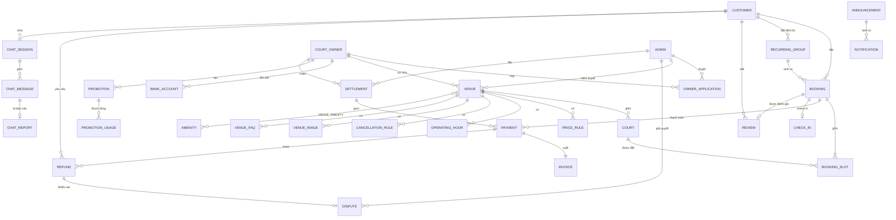
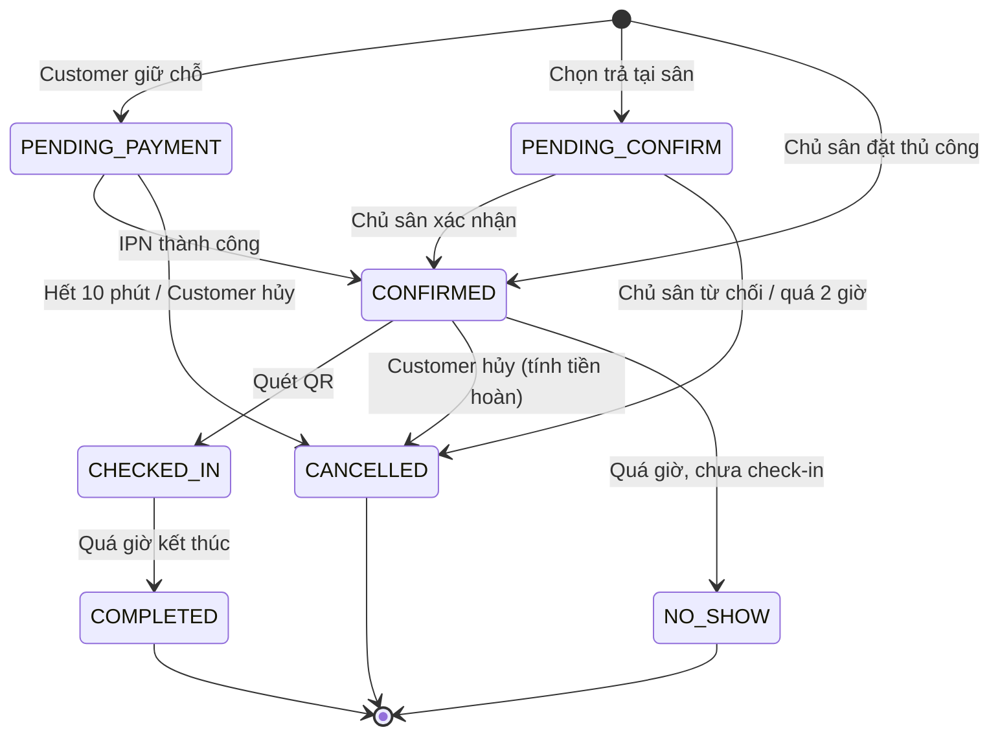

# 02 – Database

Hệ quản trị: **SQL Server** (xem quyết định D1). Quản lý schema bằng **Flyway**, không dùng `spring.jpa.hibernate.ddl-auto=update`.

```properties
spring.jpa.hibernate.ddl-auto=validate
spring.flyway.locations=classpath:db/migration
```

## 1. Sơ đồ quan hệ (rút gọn)

Customer, CourtOwner, Admin là **3 bảng riêng**. Bảng dùng chung cho nhiều actor (OTP, phiên đăng nhập, thông báo…) có 3 cột khóa ngoại nullable `customer_id`, `owner_id`, `admin_id` và ràng buộc CHECK để đúng một cột khác NULL.



## 2. Danh sách bảng theo module

| Module | Bảng | Ghi chú |
|---|---|---|
| Actor | `customer`, `court_owner`, `admin` | Email UNIQUE trong từng bảng |
| Bảo mật | `otp_code`, `trusted_device`, `auth_session`, `login_log`, `account_action_log` | Bảng dùng chung 3 actor (3 FK nullable) |
| Chủ sân | `owner_application`, `bank_account` | Số tài khoản lưu mã hóa |
| Sân | `venue`, `venue_image`, `amenity`, `venue_amenity`, `court`, `operating_hour`, `price_rule`, `cancellation_rule`, `venue_faq` | Đã có dữ liệu giả |
| Đặt sân | `recurring_group`, `booking`, `booking_slot`, `check_in`, `review`, `review_report` | `review_report` là bổ sung G1 |
| Thanh toán | `payment_gateway`, `payment`, `invoice`, `refund`, `dispute`, `promotion`, `promotion_usage`, `commission_config`, `settlement` | Tiền kiểu `BIGINT` (VNĐ) |
| Thông báo | `device_token`, `notification_setting`, `announcement`, `notification` | |
| Chat AI | `ai_config`, `chat_session`, `chat_message`, `chat_report` | |

Chi tiết cột của từng bảng lấy theo tài liệu "Entity & Relationship" của nhóm. Khi thêm hoặc đổi cột, cập nhật đồng thời migration và tài liệu này.

## 3. Ràng buộc và index bắt buộc

| Bảng | Ràng buộc / Index | Lý do |
|---|---|---|
| `booking_slot` | `UNIQUE (court_id, play_date, start_time)` lọc theo lượt còn hiệu lực | Chống đặt trùng (N2). Dùng *filtered unique index* của SQL Server: `WHERE is_active = 1` để lượt đã hủy không chiếm chỗ |
| `booking_slot` | Index `(court_id, play_date)` | Truy vấn lịch trống |
| `venue` | Index `(status, latitude, longitude)` | Tìm sân gần tôi |
| `price_rule` | CHECK `start_time < end_time`, CHECK `price_per_hour > 0` | US-O06 |
| `court` | `UNIQUE (venue_id, name)` | US-O05 |
| `promotion` | `UNIQUE (code)` | US-O15 |
| `review` | `UNIQUE (booking_id)` | Mỗi lượt đặt 1 đánh giá |
| `otp_code`, `auth_session`, `login_log`, `notification`, `device_token` | CHECK đúng một trong `customer_id`, `owner_id`, `admin_id` khác NULL | Tách 3 actor |

Ví dụ ràng buộc đặt trùng:

```sql
ALTER TABLE booking_slot ADD is_active BIT NOT NULL DEFAULT 1;

CREATE UNIQUE INDEX ux_slot_active
ON booking_slot (court_id, play_date, start_time)
WHERE is_active = 1;
```

Khi hủy lượt đặt, đặt `is_active = 0` cho các slot của lượt đó để khung giờ trống lại.

## 4. Trạng thái Booking



## 5. Kế hoạch migration Flyway

Đặt tại `src/main/resources/db/migration/`. **Không sửa migration đã merge**, muốn đổi thì tạo file mới.

| File | Nội dung | Người làm |
|---|---|---|
| `V1__actor_and_security.sql` | customer, court_owner, admin, otp_code, trusted_device, auth_session, login_log, account_action_log | Bảo mật |
| `V2__owner_onboarding.sql` | owner_application, bank_account | Bảo mật / Payment |
| `V3__venue.sql` | Các bảng module Sân | Database |
| `V4__booking.sql` | recurring_group, booking, booking_slot, check_in, review, review_report | Database |
| `V5__payment.sql` | Các bảng thanh toán | Payment |
| `V6__notification.sql` | Các bảng thông báo | Notifications |
| `V7__chat.sql` | Các bảng Chat AI | Chat AI |
| `V100__seed_demo.sql` | Tài khoản demo 3 role, dữ liệu module Sân, vài lượt đặt mẫu | Database |

Số `V100` tách riêng seed khỏi schema, để thêm migration schema `V8`, `V9`… mà không đụng seed. Dữ liệu module Sân lấy từ `seed_module_san.sql` (bỏ phần `DROP`/`CREATE`, chỉ giữ `INSERT`, đổi tên bảng sang snake_case và giá trị trạng thái sang IN HOA như `ACTIVE`, `PENDING_REVIEW`).
