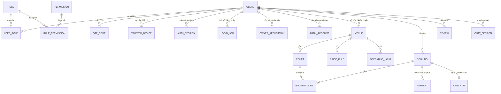
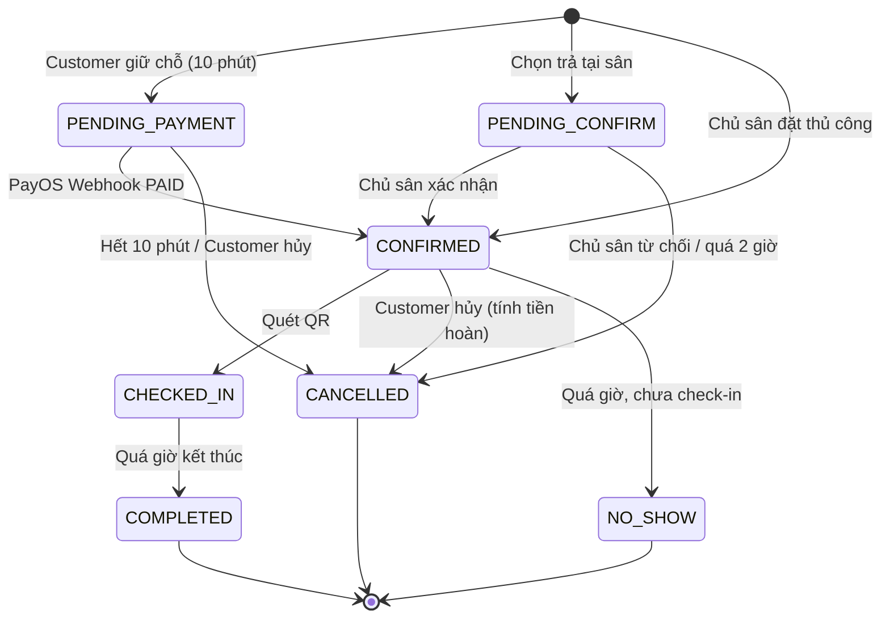

# 02 - Database (SQLite & Mô hình RBAC)

Hệ quản trị: **SQLite** (chế độ `WAL`, bật `foreign_keys=on`, `busy_timeout=5000`, xem quyết định D1). Quản lý schema bằng **Flyway**, kiểm tra nghiêm ngặt qua `spring.jpa.hibernate.ddl-auto=validate`.

```properties
spring.datasource.url=jdbc:sqlite:badminton.db?foreign_keys=on&journal_mode=WAL&busy_timeout=5000
spring.datasource.hikari.maximum-pool-size=1
spring.jpa.database-platform=org.hibernate.community.dialect.SQLiteDialect
spring.jpa.hibernate.ddl-auto=validate
spring.flyway.locations=classpath:db/migration
```

## 1. Sơ đồ quan hệ RBAC & Nghiệp vụ

Toàn bộ người dùng (`Customer`, `CourtOwner`, `Admin`) được hợp nhất vào bảng `users` và phân quyền theo mô hình **RBAC (`role`, `permission`, `role_permission`, `user_role`)**. Các bảng bảo mật và nghiệp vụ tham chiếu trực tiếp tới `users(id)` thông qua khóa ngoại `user_id`.



## 2. Danh sách bảng theo module

| Module | Bảng | Ghi chú |
|---|---|---|
| RBAC & Tài khoản | `role`, `permission`, `role_permission`, `users`, `user_role` | `users.email` UNIQUE, `users.firebase_uid` UNIQUE (liên kết Firebase Authentication), `auth_provider` (`LOCAL`, `GOOGLE`, `BOTH`) |
| Bảo mật & OTP | `otp_code`, `trusted_device`, `auth_session`, `login_log`, `account_action_log` | Tham chiếu `user_id REFERENCES users(id)`. Bảng `otp_code` có `encrypted_pending_secret` (AES-256-GCM) để tạo user Firebase sau khi xác thực OTP rồi xóa ngay |
| Chủ sân (Onboarding) | `owner_application`, `bank_account` | `user_id REFERENCES users(id)`; số tài khoản ngân hàng lưu mã hóa |
| Sân cầu lông | `venue`, `venue_image`, `amenity`, `venue_amenity`, `court`, `operating_hour`, `price_rule`, `cancellation_rule`, `venue_faq` | `owner_id REFERENCES users(id)` |
| Đặt sân | `recurring_group`, `booking`, `booking_slot`, `check_in`, `review`, `review_report` | `customer_id REFERENCES users(id)` |
| Thanh toán PayOS | `payment_gateway`, `payment`, `invoice`, `refund`, `dispute`, `promotion`, `promotion_usage`, `commission_config`, `settlement` | Tiền kiểu `INTEGER` / `BIGINT` (VNĐ) |
| Thông báo | `device_token`, `notification_setting`, `announcement`, `notification` | `user_id REFERENCES users(id)` |
| Chat AI | `ai_config`, `chat_session`, `chat_message`, `chat_report` | `user_id REFERENCES users(id)` |

## 3. Ràng buộc và Index bắt buộc trên SQLite

| Bảng | Ràng buộc / Index | Lý do |
|---|---|---|
| `users` | `UNIQUE (email)`, `UNIQUE (firebase_uid)` | Đảm bảo mỗi email và mỗi tài khoản Firebase Authentication là duy nhất |
| `role`, `permission` | `UNIQUE (code)` | Định danh duy nhất cho Role (`CUSTOMER`, `OWNER`, `ADMIN`) và Permission |
| `trusted_device` | `UNIQUE (user_id, device_id)` | Mỗi thiết bị tin cậy chỉ lưu 1 bản ghi trên mỗi tài khoản |
| `booking_slot` | `CREATE UNIQUE INDEX ux_slot_active ON booking_slot (court_id, play_date, start_time) WHERE is_active = 1` | Partial Unique Index của SQLite chống đặt trùng khung giờ (N2); lượt đã hủy (`is_active = 0`) không chiếm chỗ |
| `venue` | Index `(status, latitude, longitude)` | Tìm sân gần tôi |
| `price_rule` | CHECK `start_time < end_time`, CHECK `price_per_hour > 0` | US-O06 |
| `court` | `UNIQUE (venue_id, name)` | US-O05 |
| `promotion` | `UNIQUE (code)` | US-O15 |
| `review` | `UNIQUE (booking_id)` | Mỗi lượt đặt 1 đánh giá |

## 4. Trạng thái Booking



## 5. Kế hoạch migration Flyway (`src/main/resources/db/migration/`)

| File | Nội dung | Trạng thái |
|---|---|---|
| [V1__actor_and_security.sql](file:///d:/badminton/badminton_be/src/main/resources/db/migration/V1__actor_and_security.sql) | `role`, `permission`, `role_permission`, `users`, `user_role`, `otp_code`, `trusted_device`, `auth_session`, `login_log`, `account_action_log` | Đã hoàn thành |
| [V2__owner_onboarding.sql](file:///d:/badminton/badminton_be/src/main/resources/db/migration/V2__owner_onboarding.sql) | `owner_application`, `bank_account` + seed 3 role (`CUSTOMER`, `OWNER`, `ADMIN`) và 8 permissions | Đã hoàn thành |
| `V3__venue.sql` | Các bảng module Sân (`venue`, `court`, `price_rule`, `operating_hour`, `amenity`...) | Giai đoạn tiếp theo |
| `V4__booking.sql` | `recurring_group`, `booking`, `booking_slot`, `check_in`, `review`, `review_report` | Giai đoạn tiếp theo |
| `V5__payment.sql` | Các bảng thanh toán PayOS (`payment`, `invoice`, `refund`, `promotion`, `settlement`) | Giai đoạn tiếp theo |
| `V6__notification.sql` | Các bảng thông báo (`device_token`, `notification_setting`, `notification`) | Giai đoạn tiếp theo |
| `V7__chat.sql` | Các bảng Chat AI (`ai_config`, `chat_session`, `chat_message`, `chat_report`) | Giai đoạn tiếp theo |
