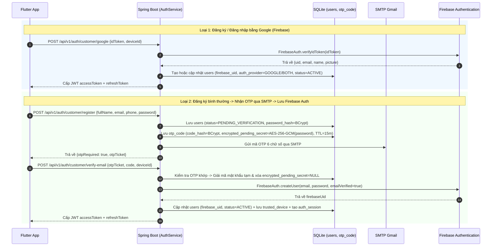

# 04 - Bảo mật tài khoản (RBAC, OTP SMTP & Firebase Authentication)

## 1. Mô hình RBAC (`User`, `Role`, `Permission`) & JWT

Hệ thống quản lý người dùng tập trung tại bảng `users` và phân quyền qua `role` (`CUSTOMER`, `OWNER`, `ADMIN`) cùng `permission` chi tiết.

| Token | Thời hạn | Lưu ở đâu |
|---|---|---|
| Access token (JWT) | 15 phút | Bộ nhớ ứng dụng Flutter, gửi qua header `Authorization: Bearer <token>` |
| Refresh token (256-bit ngẫu nhiên) | 7 ngày | Lưu trên thiết bị; Backend chỉ lưu bản băm `SHA-256` trong bảng `auth_session.refresh_token_hash` |

Payload Access Token:

```json
{
  "sub": "1",
  "email": "customer@badminton.vn",
  "sid": 15,
  "roles": ["CUSTOMER"],
  "permissions": ["BOOKING_CREATE", "BOOKING_VIEW_OWN", "CHAT_AI_USE"],
  "iat": 1761470000,
  "exp": 1761470900
}
```

- `JwtAuthFilter` kiểm tra chữ ký JWT và đối chiếu `sid` với bảng `auth_session`: nếu phiên đã bị thu hồi (`revoked_at != null`) do đăng xuất hoặc đặt lại mật khẩu, token bị từ chối ngay lập tức.
- `@CurrentActor AuthenticatedUser` cung cấp `userId`, `email`, `sessionId`, `roles` và `permissions` trực tiếp cho các Controller.

## 2. Hai luồng Đăng ký & Đồng bộ Firebase Authentication



## 3. Quy tắc OTP (`OtpService` & `MailSenderService`)

| Thông số | Giá trị áp dụng | Story |
|---|---|---|
| Độ dài | 6 chữ số, sinh bằng `SecureRandom` | C04 |
| Lưu trữ | Băm bằng `BCrypt` (`code_hash`), không lưu plain-text | Tiêu chí chung |
| Mật khẩu chờ đồng bộ Firebase | Mã hóa đối xứng `AES-256-GCM` (`SecretCipherService`) trong `encrypted_pending_secret`, tự động xóa về `NULL` ngay khi xác thực OTP xong | C01, C02 |
| Thời hạn hiệu lực (TTL) | **15 phút** cho `VERIFY_EMAIL`; **5 phút** cho `LOGIN`, `RESET_PASSWORD`, `CHANGE_PASSWORD`, `BANK_ACCOUNT` | C02, C04 |
| Giới hạn nhập sai | Tối đa **3 lần sai** trên mỗi mã OTP (`400 OTP_MAX_ATTEMPTS`) | C04 |
| Cooldown gửi lại | **60 giây** giữa 2 lần gửi (`429 OTP_COOLDOWN`); mã cũ chưa dùng tự động bị hủy khi phát hành mã mới | C02 |
| Giới hạn theo giờ | Tối đa **5 OTP / giờ / tài khoản** (`429 OTP_HOURLY_LIMIT`) | C04 |

## 4. Luồng Đăng nhập, Thiết bị tin cậy & Khóa tạm thời

1. **Kiểm tra mật khẩu & Khóa tạm 15 phút**:
   - Mỗi lần thử đăng nhập đều được ghi vào bảng `login_log` (kèm IP, `deviceId`, trạng thái và lý do).
   - Nếu nhập sai mật khẩu **5 lần liên tiếp**, tài khoản bị đặt `locked_until = NOW() + 15 phút` và trả về `403 ACCOUNT_LOCKED`.
2. **Kiểm tra thiết bị tin cậy (`trusted_device`)**:
   - Nếu `deviceId` gửi lên đã tồn tại trong bảng `trusted_device` của `user_id` đó: cập nhật `last_used_at` và cấp luôn cặp `accessToken` + `refreshToken` (`otpRequired = false`).
   - Nếu `deviceId` mới (thiết bị lạ): Backend phát hành mã OTP `LOGIN` (5 phút) gửi qua SMTP và trả `{ otpRequired: true, otpTicket }`.
   - Đối với vai trò `ADMIN`: nếu nhập sai mã OTP đăng nhập 3 lần liên tiếp, tài khoản Admin bị khóa tạm **30 phút**.
3. **Đặt lại mật khẩu (`reset-password`)**:
   - Sau khi xác thực mã OTP `RESET_PASSWORD`, Backend cập nhật `password_hash` trong SQLite, gọi `FirebaseAuthService.updatePasswordInFirebase(...)` để đồng bộ mật khẩu trên Firebase Authentication, đồng thời **thu hồi toàn bộ `auth_session`** đang hoạt động của người dùng đó.
