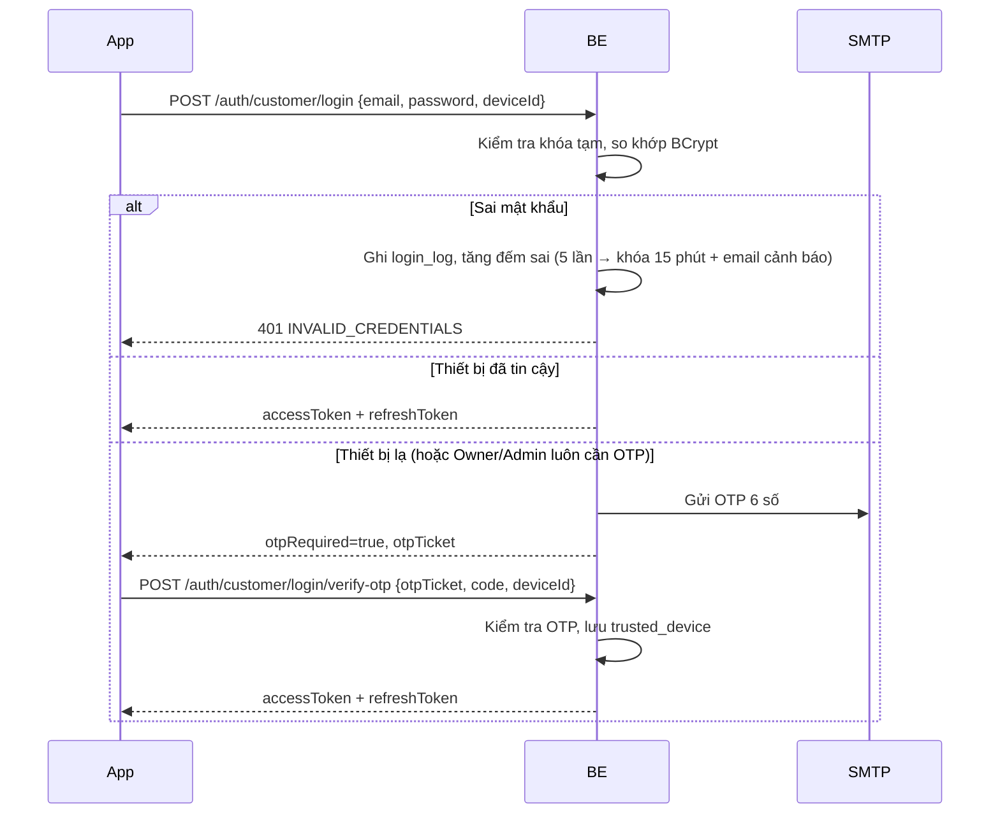

# 04 – Bảo mật tài khoản (chủ đề 4)

## 1. JWT cho 3 actor tách biệt

| Token | Thời hạn | Lưu ở đâu |
|---|---|---|
| Access token (JWT) | 15 phút | Bộ nhớ app, gửi qua header `Authorization: Bearer` |
| Refresh token (chuỗi ngẫu nhiên) | 7 ngày | `flutter_secure_storage` trên máy; BE lưu bản băm trong `auth_session` |

Payload access token:

```json
{ "sub": "42", "role": "CUSTOMER", "sid": "auth_session.id", "iat": 1761470000, "exp": 1761470900 }
```

- `sub` là id trong bảng của đúng actor đó. Vì 3 bảng có thể trùng id, **luôn đọc kèm `role`**.
- `CurrentActor` (đọc từ SecurityContext) trả về `{ role, id }` cho service dùng.
- Đăng xuất, đổi/đặt lại mật khẩu, bị Admin khóa → đặt `revoked_at` cho các `auth_session` liên quan. Refresh token bị thu hồi thì không đổi được access token mới.

Cấu hình phân quyền:

```java
http.authorizeHttpRequests(a -> a
    .requestMatchers("/api/v1/auth/**", "/api/v1/public/**", "/api/v1/webhooks/**",
                     "/swagger-ui/**", "/v3/api-docs/**").permitAll()
    .requestMatchers("/api/v1/customer/**").hasRole("CUSTOMER")
    .requestMatchers("/api/v1/owner/**").hasRole("OWNER")
    .requestMatchers("/api/v1/admin/**").hasRole("ADMIN")
    .anyRequest().authenticated());
```

## 2. Quy tắc OTP

| Thông số | Giá trị | Story |
|---|---|---|
| Độ dài | 6 chữ số, sinh bằng `SecureRandom` | C04 |
| Lưu trữ | Băm (BCrypt hoặc SHA-256 + salt), không lưu plain text | Tiêu chí chung |
| Hiệu lực | 15 phút cho xác thực email; 5 phút cho các mục đích khác | C02, C04 |
| Thử sai | 3 lần thì vô hiệu OTP | C04 |
| Gửi lại | Sau 60 giây; mã cũ mất hiệu lực khi gửi mã mới | C02 |
| Giới hạn gửi | 5 OTP / giờ / tài khoản | C04 |
| Mục đích (`purpose`) | `VERIFY_EMAIL`, `LOGIN`, `RESET_PASSWORD`, `CHANGE_PASSWORD`, `BANK_ACCOUNT` | — |

Một OTP chỉ dùng được cho đúng `purpose` đã tạo ra nó.

## 3. Luồng đăng nhập



`otpTicket` là chuỗi ngẫu nhiên ngắn hạn gắn với lần đăng nhập đã qua bước mật khẩu, tránh việc bỏ qua bước mật khẩu mà chỉ đoán OTP.

## 4. Các yêu cầu bảo mật khác

| Yêu cầu | Cách làm | Story |
|---|---|---|
| Không dò được tài khoản | Quên mật khẩu luôn trả cùng một thông báo; đăng nhập sai không nói rõ sai email hay mật khẩu | C03, C05 |
| Khóa tạm khi đoán mật khẩu | 5 lần sai liên tiếp → khóa 15 phút (Customer, Owner); Admin 3 lần OTP sai → 30 phút | C03, A01 |
| Ghi log đăng nhập | Mỗi lần đăng nhập ghi `login_log` (IP, thiết bị, kết quả); job gắn cờ bất thường | A04 |
| Rate limit | Giới hạn theo IP cho `/auth/**` (ví dụ dùng Bucket4j) | N4 |
| Chống IDOR | Service so `venue.ownerId` với `CurrentActor.id` trước mọi thao tác | N5 |
| Che dữ liệu nhạy cảm | Số tài khoản ngân hàng mã hóa AES khi lưu, trả về dạng `****1234` | O12 |
| Bí mật cấu hình | JWT secret, mật khẩu SMTP, khóa VNPay, khóa AI đặt trong `application-local.properties` (không commit) hoặc biến môi trường | N3 |

## 5. Gợi ý bài lab cho lớp (2–3 bài)

1. **Lab 1 – Xác thực email bằng OTP:** sinh OTP, băm, gửi qua SMTP Gmail, kiểm tra hết hạn và số lần thử.
2. **Lab 2 – JWT + phân quyền theo role:** cấu hình Spring Security cho 3 tiền tố URL, viết filter đọc token, kiểm tra 401/403 bằng Postman.
3. **Lab 3 – Đăng nhập Google:** Flutter lấy Google ID token, BE xác minh và cấp JWT của hệ thống.
