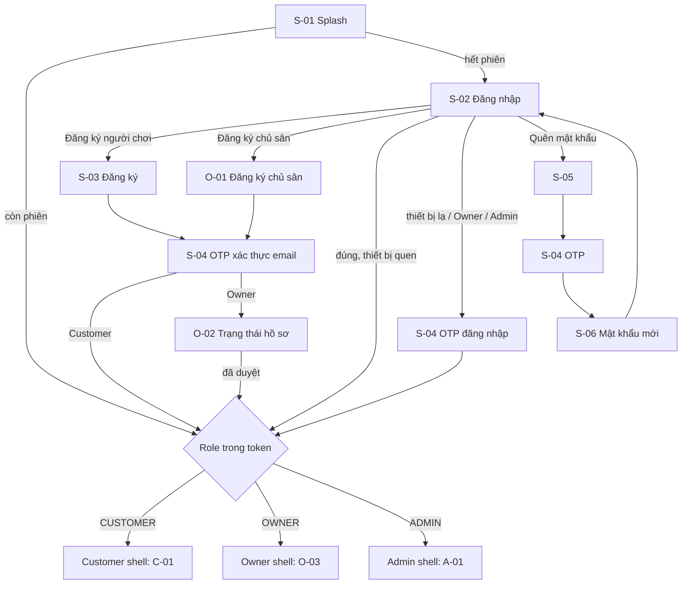
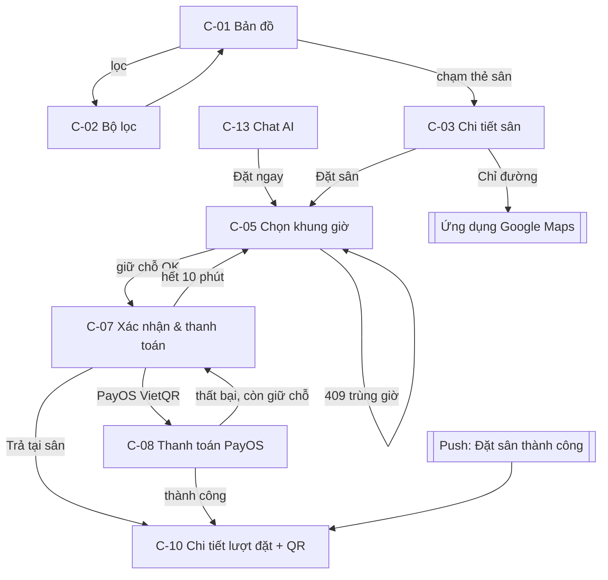
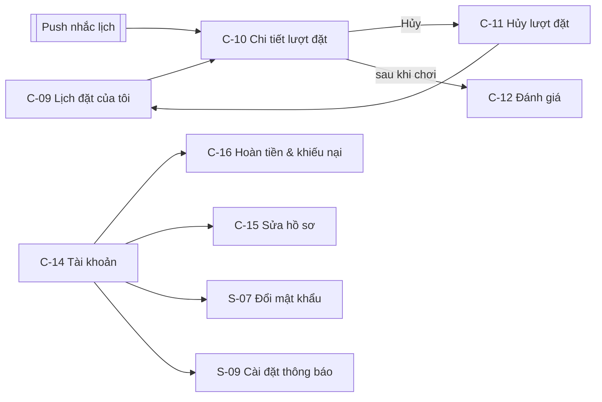
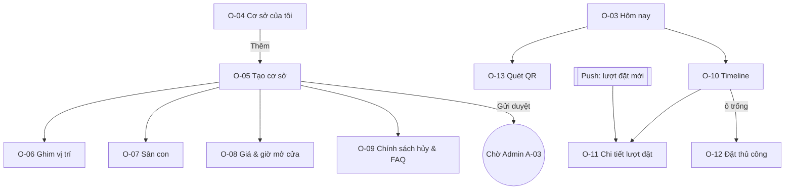
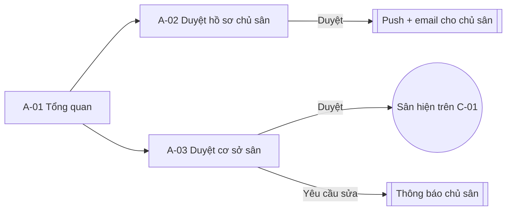

# 04 – Luồng điều hướng

ID màn hình tra ở [03-danh-sach-man-hinh.md](03-danh-sach-man-hinh.md).

## 1. Vào app và xác thực (MF1)

## 2. Customer – Đặt sân & thanh toán (MF2, luồng demo chính)

## 3. Customer – Sau khi đặt (MF3, MF4)

## 4. CourtOwner – Đưa sân lên và vận hành (MF5, MF6)

## 5. Admin – Duyệt (phần MVP của MF5)

## 6. Điều hướng khi chạm thông báo

| `data.type` | Mở màn hình |
|---|---|
| `BOOKING` | C-10 (Customer) / O-11 (Owner) |
| `REFUND` | C-16 / O-15 |
| `OWNER_APPLICATION` | O-02 |
| `VENUE_REVIEW` | O-05 |
| `ANNOUNCEMENT` | S-08 (mở rộng nội dung) |
